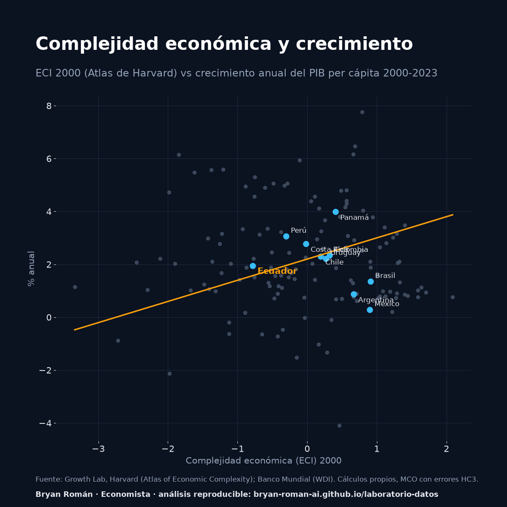

# ¿La complejidad económica predice el crecimiento? Ecuador en el Atlas de Harvard

**Pregunta:** ¿Los países que exportaban productos más complejos en 2000 crecieron más hasta 2023, y dónde queda Ecuador?

*Bryan Román · Economista — análisis reproducible, 26-11-2026. Todos los números salen del código de este repositorio con datos públicos; nada se escribió a mano.*

## Hallazgos

- En 140 países, cada punto más de complejidad económica (ECI del Atlas de Harvard) en 2000 se asocia con 0,80 puntos porcentuales más de crecimiento anual del PIB per cápita 2000-2023, a igual ingreso inicial (p=0,000; bootstrap IC 95%: 0,42 a 1,24).
- Ranking de complejidad 2023 entre 144 países con más de 1 millón de habitantes y exportaciones de más de US$ 1.000 millones: México #28, Brasil #56, Costa Rica #63, Colombia #66, Panamá #68, Uruguay #76, Argentina #77, Chile #85, Perú #100, Ecuador #112.
- Ecuador: ECI -0,78 en 2000 y -1,03 en 2023; creció 1,95% anual per cápita vs 1,56% que predice el modelo con su complejidad e ingreso inicial.

## Método

ECI país-año del Atlas of Economic Complexity (Growth Lab, Harvard, API GraphQL pública), países con ≥ 1 millón de habitantes y exportaciones ≥ US$ 1.000 millones en 2023. Crecimiento anual compuesto del PIB per cápita a precios constantes (Banco Mundial, NY.GDP.PCAP.KD) 2000-2023. MCO crecimiento ~ ECI inicial + log PIB pc inicial (convergencia condicional), errores HC3. Checks: reproducción numpy, bootstrap, recorte de extremos.

## Comprobaciones automáticas

| Comprobación | Tipo | Resultado | Detalle |
|---|---|---|---|
| reproducción numpy | integridad | ✅ | coeficientes idénticos |
| cobertura ≥ 80 países | integridad | ✅ | 140 países |
| bootstrap (1999 remuestreos) del efecto ECI | integridad | ✅ | IC 95% 0,42 a 1,24 |
| sin el 2% extremo de crecimiento: mismo signo | robustez | ✅ | 0,59 vs 0,80 |

Las comprobaciones de *integridad* deben pasar para publicar. Las de *robustez* no bloquean: deciden cómo se redacta el resultado (robusto vs. no concluyente).

Estado: **integridad verificada**.

## Limitaciones

- El ECI se recalcula con cada versión del Atlas.
- Correlación entre países: no prueba que subir el ECI cause crecimiento.
- Un solo periodo largo; no capta crisis intermedias.

## Literatura relacionada

Referencias encontradas en Crossref por tema (metadatos reales con DOI; listadas como contexto, no como respaldo de los resultados de arriba).

- Li (2021). *[Retracted] Grey Correlation Analysis of Economic Growth and Cultural Industry Competitiveness*. Complexity. https://doi.org/10.1155/2021/5594080
- Cao (2021). *Ink Art Three‐Dimensional Big Data Three‐Dimensional Display Index Prediction Model*. Complexity. https://doi.org/10.1155/2021/5564361
- Chifurira, Chikobvu, Dubihlela (2016). *Rainfall prediction for sustainable economic growth*. Environmental Economics. https://doi.org/10.21511/ee.07(4-1).2016.04
- Dzotsenidze (2021). *ECONOMIC COMPLEXITY INDEX (ECI) AS BEST INDICATOR FOR GROWTH PREDICTION*. Economic Profile. https://doi.org/10.52244/ep.2021.21.11
- Ivanova, Strand, Leydesdorff (2017). *Extending Economic Complexity Index to a Ternary Complexity Index*. SSRN Electronic Journal. https://doi.org/10.2139/ssrn.3072335

## Datos y procedencia

| Archivo | Fuente | Descargado | SHA-256 |
|---|---|---|---|
| `data/atlas_paises.json` | https://atlas.hks.harvard.edu/api/graphql | 2026-11-26T18:03:23 | `4399878a2c01a890…` |
| `data/atlas_countryYear_2000_2023.json` | https://atlas.hks.harvard.edu/api/graphql | 2026-11-26T18:03:24 | `8f6e29474b2f4a51…` |
| `data/wb_NY.GDP.PCAP.KD_2000.json` | https://api.worldbank.org/v2/country/all/indicator/NY.GDP.PCAP.KD?format=json&date=2000&per_page=400 | 2026-11-26T18:03:24 | `9f1d5de78b7c60af…` |
| `data/wb_NY.GDP.PCAP.KD_2023.json` | https://api.worldbank.org/v2/country/all/indicator/NY.GDP.PCAP.KD?format=json&date=2023&per_page=400 | 2026-11-26T18:03:24 | `29babdb00b984719…` |

Para repetirlo: `pip install -r requirements.txt && python codigo/correr.py eci-crecimiento-ecuador`
