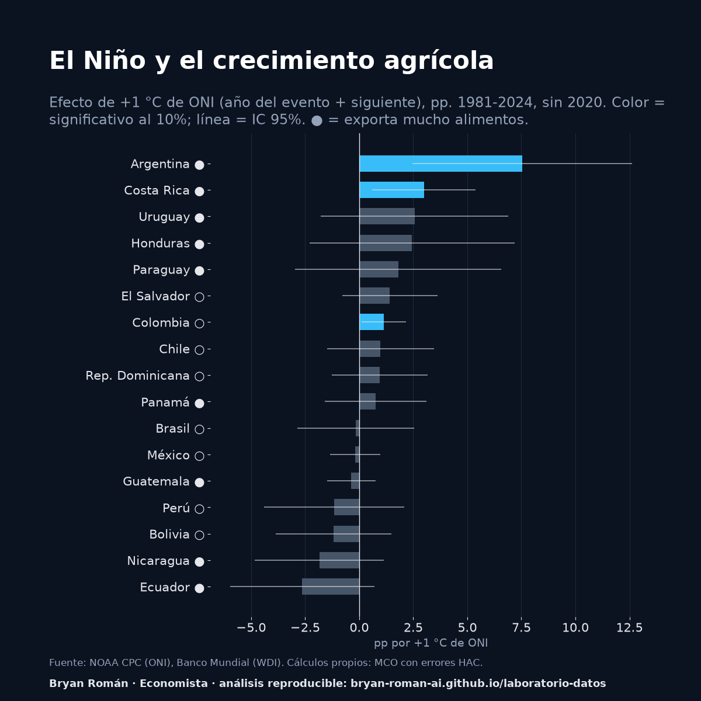

# El Niño y la agricultura de América Latina, país por país

**Pregunta:** ¿Cuánto cambia el crecimiento agrícola de cada país latinoamericano cuando El Niño se intensifica, y depende de si exporta alimentos?

*Bryan Román · Economista — análisis reproducible, 26-11-2026. Todos los números salen del código de este repositorio con datos públicos; nada se escribió a mano.*

## Hallazgos

- El índice ONI de NOAA (anomalía de temperatura del Pacífico, la medida oficial de El Niño) marcó 2,46 °C en ASO 2026; solo 2 estaciones trimestrales desde 1950 lo igualan o superan.
- En el promedio de 17 países de América Latina (1981-2024, sin 2020) NO hay un efecto regional claro de El Niño sobre el crecimiento agrícola: 0,30 pp por +1 °C (año del evento + siguiente), prueba de permutación p=0,543. El promedio esconde países que se mueven en sentidos opuestos.
- Separando por tipo de comercio, los países con más peso de alimentos en sus exportaciones difieren en 1,10 pp por +1 °C respecto de los demás (p=0,160, no significativo).
- País por país: 3 de 17 muestran un efecto distinto de cero al 10%. Mayor efecto negativo: Ecuador (-2,63 pp por +1 °C; p=0,121); mayor positivo: Argentina (7,53 pp; p=0,004).
- Ecuador: -2,63 pp de crecimiento agrícola por cada +1 °C de ONI (IC 95%: -5,96 a 0,69; p=0,121; 43 años), no distinguible de cero con datos anuales.

## Método

Variable climática: media anual del ONI de NOAA CPC y su rezago de un año (el efecto se mide como la suma: año del evento + año siguiente); robustez con el máximo anual. Resultado: Agriculture, forestry, and fishing, value added (annual % growth) (NV.AGR.TOTL.KD.ZG). Por país: MCO con crecimiento mundial como control y errores HAC (Newey-West, 2 rezagos). Panel: efectos fijos de país e interacción con el grupo de países con peso alto de alimentos en sus exportaciones (TX.VAL.FOOD.ZS.UN, promedio de los últimos 15 años, corte en la mediana), errores agrupados por año. Prueba de permutación (999 barajas de la secuencia anual del ONI). Robustez: dejar un país fuera.

## Comprobaciones automáticas

| Comprobación | Tipo | Resultado | Detalle |
|---|---|---|---|
| reproducción numpy = statsmodels (por país) | integridad | ✅ | máx. diferencia 8.88e-15 |
| cobertura: ≥ 12 países con ≥ 25 años | integridad | ✅ | 17 países, n mediano 43 |
| definición alternativa (ONI máximo del año): mismo signo por país | robustez | ✅ | 88% de los países conservan el signo |
| dejar un país fuera: el efecto regional conserva el signo | robustez | ✅ | rango 0,14 a 0,51 |
| prueba de permutación del efecto regional (999) | robustez | ⚠️ no pasa | p=0,543 |

Las comprobaciones de *integridad* deben pasar para publicar. Las de *robustez* no bloquean: deciden cómo se redacta el resultado (robusto vs. no concluyente).

Estado: **integridad verificada**.

## Limitaciones

- Asociación, no causalidad: otros choques del mismo año (precios de materias primas) pueden coincidir con El Niño.
- Datos anuales: el efecto dentro del año (temporada de lluvias) se diluye.
- La segmentación por tipo de comercio usa la participación de alimentos en las exportaciones de mercancías.

## Literatura relacionada

Referencias encontradas en Crossref por tema (metadatos reales con DOI; listadas como contexto, no como respaldo de los resultados de arriba).

- Perrotti (2016). *The People’s Republic of China and Latin America: The impact of Chinese economic growth on Latin American exports*. CEPAL Review. https://doi.org/10.18356/c6391b0e-en
- Córdoba-Balcells, Parada-Molina, Toboso-Chavero (2025). *Socio-economic impact of urban agriculture in Latin America cities: The case of Santiago de Chile*. Cities. https://doi.org/10.1016/j.cities.2025.105905
- , Kuwayama (2015). *Japan Latin America Relations Then and Now - The Japan Model of Economic Engagement: Opportunities for Latin America and The Caribbean*. revista digital mundo asia pacífico. https://doi.org/10.17230/map.v4.i7.01
- Boonman (2016). *THE ECONOMIC IMPACT OF SOVEREIGN DEFAULTS IN LATIN AMERICA 1870-2012*. Revista de Historia Económica / Journal of Iberian and Latin American Economic History. https://doi.org/10.1017/s0212610916000136
- Villafuerte-Pezo, García-Pacheco de Mercado, Lescano-Lopez (2022). *Autonomía económica y género en el sector rural de América Latina*. HUMAN REVIEW. International Humanities Review / Revista Internacional De Humanidades. https://doi.org/10.37819/revhuman.v14i1.1187

## Datos y procedencia

| Archivo | Fuente | Descargado | SHA-256 |
|---|---|---|---|
| `data/noaa_oni.txt` | https://www.cpc.ncep.noaa.gov/data/indices/oni.ascii.txt | 2026-11-26T18:03:01 | `118c563331335c86…` |
| `data/wb_NV.AGR.TOTL.KD.ZG.json` | https://api.worldbank.org/v2/country/ARG;BOL;BRA;CHL;COL;CRI;DOM;ECU;GTM;HND;MEX;NIC;PAN;PER;PRY;SLV;URY;WLD/indicator/N | 2026-11-26T18:03:02 | `c6b08b4f5f678bb4…` |
| `data/wb_TX.VAL.FOOD.ZS.UN.json` | https://api.worldbank.org/v2/country/ARG;BOL;BRA;CHL;COL;CRI;DOM;ECU;GTM;HND;MEX;NIC;PAN;PER;PRY;SLV;URY;WLD/indicator/T | 2026-11-26T18:03:02 | `eba3d0628de14077…` |
| `data/wb_NY.GDP.MKTP.KD.ZG.json` | https://api.worldbank.org/v2/country/ARG;BOL;BRA;CHL;COL;CRI;DOM;ECU;GTM;HND;MEX;NIC;PAN;PER;PRY;SLV;URY;WLD/indicator/N | 2026-11-26T18:03:02 | `1ec221bae6e966fc…` |

Para repetirlo: `pip install -r requirements.txt && python codigo/correr.py nino-latam-agro`
